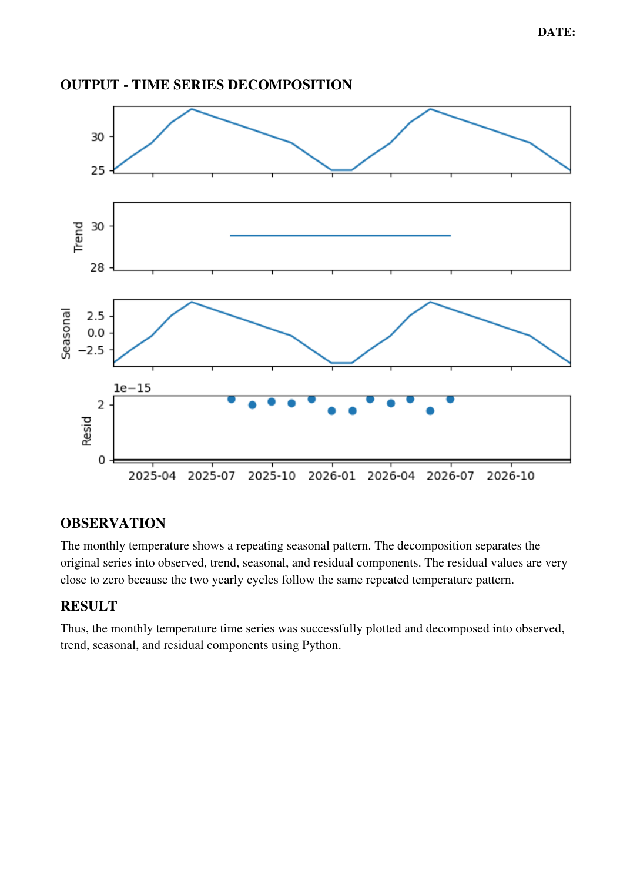

# Experiment 02 – Time Series Analysis and Decomposition

## Student Details

- **Name:** HANIEL REENA D R
- **Register No:** 2305001008

## Aim
To perform time series analysis and decomposition on the monthly average temperature of a city
using Python.

## Algorithm
1. Start the program.
2. Import Pandas, Matplotlib, and seasonal_decompose from statsmodels.
3. Create monthly temperature data for two complete yearly cycles.
4. Generate a monthly date index using Pandas.
5. Create a time-series object using the temperature values and date index.
6. Display the monthly temperature data.
7. Plot the original monthly average temperature time series.
8. Apply additive seasonal decomposition with period = 12.
9. Display the Observed, Trend, Seasonal, and Residual components.
10. Interpret the plotted components.
11. Stop the program.


## Python Program
File: `experiment_02.py`

```python
import pandas as pd
import matplotlib.pyplot as plt
from statsmodels.tsa.seasonal import seasonal_decompose
temperature = [
    25, 27, 29, 32, 34, 33,
    32, 31, 30, 29, 27, 25,
    25, 27, 29, 32, 34, 33,
    32, 31, 30, 29, 27, 25
]
dates = pd.date_range(
    start="2025-01-01",
    periods=24,
    freq="ME"
)
data = pd.Series(
    temperature,
    index=dates
)
print("Monthly Temperature:")
print(data)
plt.figure(figsize=(10, 5))
plt.plot(data.index, data.values, marker="o")
plt.title("Monthly Average Temperature")
plt.xlabel("Month")
plt.ylabel("Temperature (°C)")
plt.grid()
plt.show()
result = seasonal_decompose(
    data,
    model="additive",
    period=12
)
result.plot()
plt.show()
```

## Output
### Output Page 4


## Observation
The monthly temperature shows a repeating seasonal pattern. The decomposition separates the
original series into observed, trend, seasonal, and residual components. The residual values are very
close to zero because the two yearly cycles follow the same repeated temperature pattern.

## Result
Thus, the monthly temperature time series was successfully plotted and decomposed into observed,
trend, seasonal, and residual components using Python.

## Installation and Execution
Install the listed libraries:
```bash
pip install -r requirements.txt
```

Run the Python program from this folder:
```bash
python experiment_02.py
```

_Program and output images are transcribed/rendered from the supplied lab PDF._